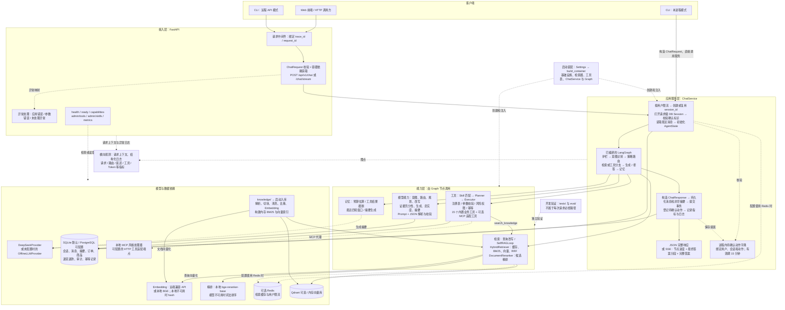
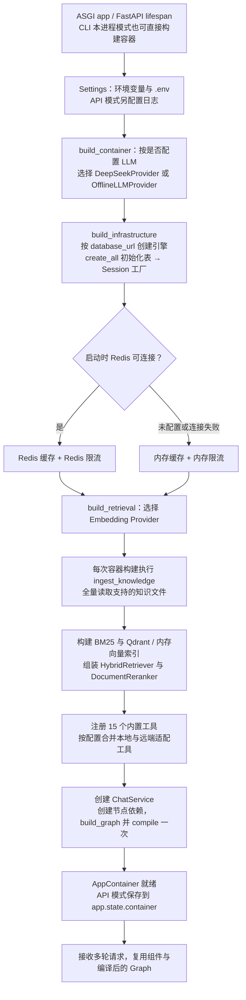
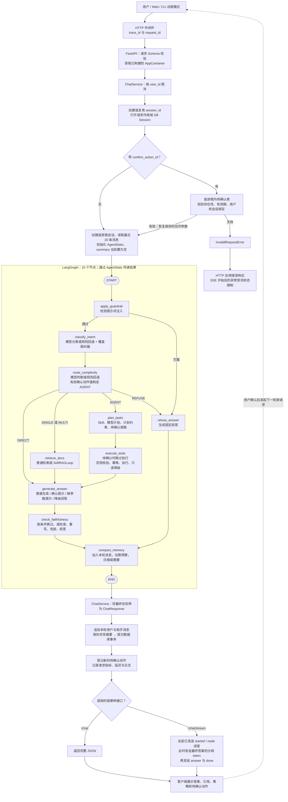
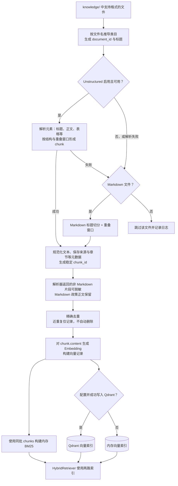
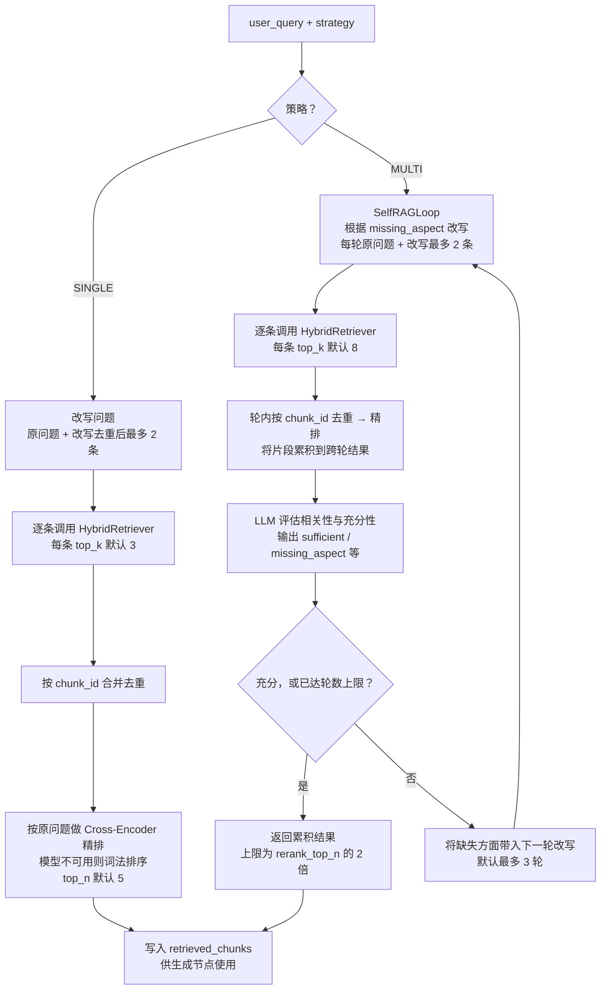
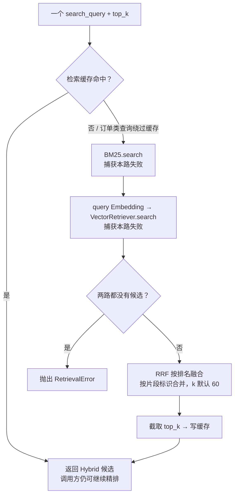
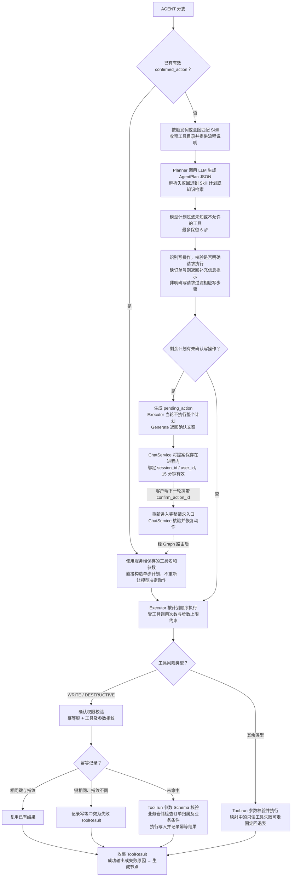
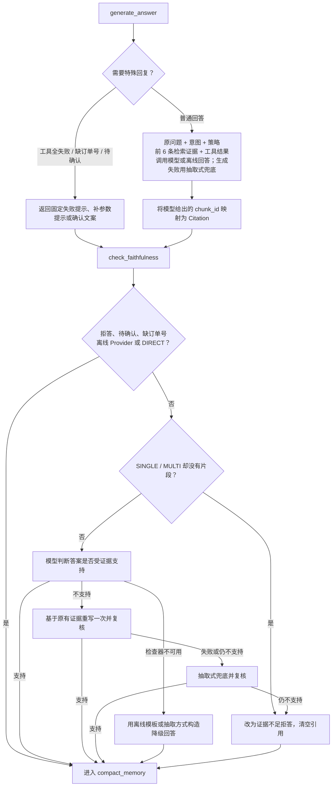
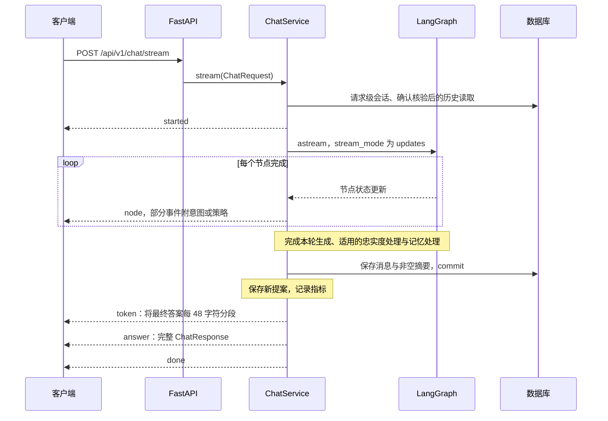

# 项目完整架构与请求流程（源码核对版）

核对日期：2026-10-28。本文描述当前工作区源码中的实现；模型、数据库等具体后端由配置与组件加载结果决定。本文没有启动服务、调用远程模型或重新运行评测。

这是一组互相对应的架构图：总图回答“系统由什么组成”，请求图回答“一次请求怎样运行”，子系统图展开检索、工具与记忆。不同图中的同名模块是同一个组件，不是重复部署的服务。

建议先读第 1、3 节，再按简历涉及的内容阅读其余部分。实线表示图内的调用或处理方向；虚线表示辅助依赖、配置装配、可选接入或未来一轮请求，具体含义在边上标明。依赖图里的分叉不代表代码并行执行。

## 1. 系统架构总图：入口、编排、能力与存储

总图中的能力调用会返回结果，省略了反向返回箭头。API 层与 ChatService 是同一后端应用中的模块，并不意味着独立微服务。

源码入口：`app/main.py`、`app/api/routes/chat.py`、`app/services/chat_service.py`、`app/services/container.py`、`app/agents/graph.py`。

## 2. 启动装配：组件先被创建，请求才开始执行

- 数据库是硬依赖；没有“PostgreSQL 连接失败后自动切到 SQLite”的逻辑。
- LLM Provider 根据配置选择；不是先探测 DeepSeek API，探测失败再全局切换 Offline Provider。真实模型调用失败由各模块分别处理。
- 当前启动每次都执行 ingest，不存在通用的“检查索引版本后直接跳过知识重建”分支。
- Cross-Encoder 可在第一次需要时加载；容器创建完成不代表全部本地模型已经完成推理验证。
- `build_container(seed=False)` 默认不写演示数据。演示数据通过显式操作准备。

源码：`app/main.py`、`app/services/container.py`、`app/repositories/db.py`、`app/providers/embeddings.py`、`app/providers/reranker.py`。

## 3. 一次请求的完整主流程：包含全部 Graph 节点

参数校验失败、限流失败、未处理的节点异常等会中断正常流程，交由对应异常路径处理；图中没有为每一个处理框重复画异常箭头。SSE 已经开始发送后，不能假定仍可改成普通 JSON 错误响应。

必须分清图上的边与节点内部行为：

- DIRECT 会进入 `check_faithfulness` 节点，但该节点对 DIRECT 直接跳过模型检查。
- REFUSE 直接进入记忆节点，不经过生成与忠实度节点。
- 待确认动作依然经过 `execute_tools` 节点，但 Executor 当轮直接返回空结果，不执行计划。
- Graph 没有从忠实度节点返回检索节点的边。检索循环封装在 `SelfRAGLoop` 内部。
- Graph 没有从 Executor 返回 Planner 的循环，也没有配置节点级 checkpointer。

源码：`app/agents/graph.py`、`app/services/chat_service.py`、`app/agents/nodes/`。

## 4. 知识准备：文件怎样变成两套索引

“知识准备”是按职责划分的数据处理阶段；当前后端启动时也会直接运行它，并不一定是独立的离线服务。

此图将不同解析路径共有的职责合并展示；清洗、切块与 ID 生成在具体函数中交织执行，不是三个独立网络服务。空知识库时跳过向量计算，仍可构建空索引。

源码：`app/retrieval/ingest.py`、`unstructured_parser.py`、`chunking.py`、`cleaning.py`、`app/providers/embeddings.py`。

## 5. 在线检索：SINGLE、MULTI 与 Hybrid 的关系

### 5.1 retrieve_docs 内部的策略分支

`SINGLE` 表示不进行证据充分性驱动的多轮循环，不表示只发出一次底层搜索。`MULTI` 评估器失败时，以“当前是否已有片段”作为充分性的回退判断，而不是强制继续搜索。

### 5.2 一次 HybridRetriever 调用

源码中 BM25 和向量搜索是先后调用，两路故障被分别隔离；“双路召回”不等于已经使用异步并行。缓存保存的是 Hybrid 阶段结果，不是最终生成答案。

源码：`app/agents/nodes/retrieval.py`、`app/retrieval/query_rewrite.py`、`self_rag.py`、`hybrid.py`、`fusion.py`、`cache.py`、`reranker.py`。

## 6. 工具分支：规划、确认、执行与数据访问

工具的具体依赖如下：

| 工具类型 | 实际依赖 |
|---|---|
| 订单、商品、物流、退换货与退款等业务工具 | 请求级 SQLAlchemy Session、仓储、演示业务数据库；不是已接入真实支付或承运商 |
| `search_knowledge` | HybridRetriever；不等于重新进入完整的 Graph 检索节点与多轮精排流程 |
| 本地 MCP 风格工具 | `app/mcp/runtime.py` 中的本地处理器 |
| 可配置的远端工具适配 | HTTP POST 到配置端点，传递工具名与参数 |

ToolRegistry 可以导出 OpenAI 风格 Function Calling Schema；当前 Planner 主路径是“工具目录文字 + 结构化 AgentPlan JSON”，不是直接把 `openai_tools()` 传给模型并依靠模型的原生 tool_calls 循环。

MCP 部分是本地代理与简化 HTTP 适配；不能从这个架构推断已经实现完整 MCP 标准客户端的协商、发现与会话生命周期。

源码：`app/agents/nodes/planner.py`、`executor.py`、`app/tools/{base,registry,factory,permissions}.py`、`app/skills/loader.py`、`app/mcp/{adapter,runtime}.py`、`app/repositories/`。

## 7. 生成、忠实度、记忆与返回

### 7.1 生成与忠实度处理

这里没有重新检索。`check_faithfulness` 是模型辅助判断，不构成绝对事实保证。当前生成 Prompt 未直接注入会话历史或摘要；它主要消费本轮问题、检索证据和工具结果。

### 7.2 记忆节点的实际位置与处理

记忆节点位于本轮生成之后。它先将本轮用户和助手消息加入内存状态，再根据“消息 + 摘要”的字符近似 Token 数决定等级；当前判级没有计算检索片段、工具结果和整份模型 Prompt 的总长度。

| 默认利用率 | 实际处理 |
|---|---|
| 低于 50% | 不进入分级压缩；工具结果仍有 10000 字符上限 |
| 50% 至不足 70% | 工具输出超长时缩为 400 字符预览 |
| 70% 至不足 85% | 工具预览缩为 160 字符；历史窗口保留最近约四轮 |
| 大于等于 85% | 在上述截窗之后生成摘要，再应用压缩；摘要失败有文本拼接回退 |

`ChatService` 会保存本轮原始用户消息和最终助手回答，以及非空摘要；不会用压缩后的窗口替换数据库的全部历史消息。当前 `_initial_state` 读取最近 20 条消息，却把 `summary` 初始化为空，没有把已保存摘要重新装入下一轮状态。这是现有链路的限制，不能将图理解为已经完成长期记忆闭环。

源码：`app/agents/nodes/memory.py`、`app/memory/{budget,compression,summarizer}.py`、`app/services/chat_service.py`、`app/repositories/session_repository.py`。

### 7.3 JSON 与 SSE 的返回区别

这是正常完成路径。非流式 `/chat` 使用 `ainvoke`，不发送这些进度事件，完成后返回完整响应。当前聊天 SSE 没有将模型原始生成 token 实时透传给客户端；因此不能把 Provider 自带的流式能力直接等同于产品端已使用它。

## 8. 状态与资源：什么随请求走，什么被复用

| 类别 | 内容 | 生命周期或位置 |
|---|---|---|
| 请求身份字段 | `trace_id`、`session_id`、`user_id`、`user_query` | 本轮 AgentState |
| 决策结果 | `intent`、`complexity`、`strategy` | 节点产生并更新 State |
| 检索数据 | `rewritten_queries`、`retrieved_chunks` | 检索节点产生，供本轮后续使用 |
| 工具数据 | `plan`、`tool_results`、`pending_action`、`confirmed_action` | 规划与执行节点使用 |
| 回答数据 | `final_answer`、`citations`、`refused`、`error` | 生成、拒答或忠实度节点更新 |
| 记忆及观测 | `messages`、`summary`、`latency`、`token_usage`、`extra` | State 内的业务数据 |
| 请求级 DB Session | SQLAlchemy AsyncSession | 通过 contextvars 供仓储型工具取得；不放入 State |
| 编译后的 Graph、工具注册表、Provider、检索器 | 可复用组件 | 容器或 ChatService 持有，跨请求复用 |
| 待确认动作表 | 动作参数、用户、会话、过期时间 | ChatService 进程内字典，不是数据库或 Redis |
| 已持久化记录 | 消息、摘要、订单、退款、审计与幂等等 | SQL 数据库；不同记录由对应仓储操作 |

节点返回局部状态更新；`AgentState` 没有无限追加消息的 reducer。会话消息持久化也不等于 Graph 节点级断点续跑。

## 9. 降级、观测与运维入口

| 场景 | 当前实现 |
|---|---|
| 数据库不可用 | 启动初始化失败或运行时出错；不自动换数据库。`ready` 的整体判定只把数据库作为硬依赖 |
| Redis 启动不可用 | 选择内存检索缓存与内存限流 |
| Redis 运行时限流出错 | 放行本次请求；不是自动切换到内存限流 |
| Redis 运行时缓存读写出错 | 缓存读视为未命中、写失败忽略；继续实际检索 |
| 配置的 Qdrant 建库或写入失败 | 启动入库降级为内存向量存储；不能推断所有运行时故障也会自动迁移 |
| 未配置 LLM | 使用 OfflineLLMProvider |
| LLM 暂时性请求错误 | Provider 对可重试错误使用指数退避和抖动；耗尽后各调用模块分别回退 |
| 本地 Embedding 加载不可用 | 构建时选择 hash；远端 Embedding API 报错不代表有通用的自动本地切换链 |
| Cross-Encoder 模型不可用 | 词法排序；不是 Cohere，也不能冒充 Cross-Encoder 成绩 |
| BM25 或向量单路失败 | 保留另一条路的候选做融合；两路都无结果抛错 |
| 只读工具失败 | 部分工具可按固定表回退；权限拒绝不进入回退，写操作没有替代写动作的回退 |
| 生成或忠实度失败 | 见第 7 节的抽取、离线模板、重写与拒答路径 |

| 运维接口 | 用途 |
|---|---|
| `/api/v1/health` | 存活状态 |
| `/api/v1/ready` | 检查数据库等依赖，报告依赖状态 |
| `/api/v1/capabilities` | 报告后端选择及降级信息；部分字段按配置推导，不等于全链路实测 |
| `/api/v1/admin/tools`、`/api/v1/admin/skills` | 查看工具与技能；管理接口使用单独的管理令牌规则 |
| `/metrics` | Prometheus 指标导出 |

路径前缀按默认 `/api/v1` 展示，可由 Settings 配置。日志与指标分布在请求入口、服务、检索和工具等模块，不是所有请求结束后才启动的单独处理服务。当前 `token_usage` 不是对意图、改写、规划、判别等全部模型调用的完整成本汇总。

## 10. 对原架构图与面试表述的校正

| 容易形成的理解 | 按当前源码应怎样理解 |
|---|---|
| 系统架构就是五条策略分支 | 五分支是 Graph 内部的控制流；外面还有接入、会话、装配、存储与返回 |
| 每个框代表独立服务或独立 Agent | 大部分是同一 Python 应用中的模块；当前没有多 Agent 团队协作 |
| 护栏节点检查所有业务边界 | 当前该节点直接调用注入检测；越界还由意图和路由处理。`boundary.py` 存在，但没有接入当前主请求链 |
| 按 0.4 / 0.7 分数阈值选策略 | 当前是模型结构化分类与规则回退，没有这组显式阈值分支 |
| SINGLE 只有一次搜索 | 可同时使用原问题和一条改写，各调用一次 Hybrid；没有充分性驱动的补检循环 |
| 忠实度失败沿 Graph 回边重查知识库 | 实际在节点内部重写或抽取；检索补证据循环位于 SelfRAGLoop |
| 确认后从中断的 Graph 节点继续 | 确认是下一轮新请求，经校验后使用保存的动作重新进入 AGENT 分支 |
| 持久化会话等于长期记忆闭环 | 当前摘要回读、历史注入生成等尚未闭环，见第 7 节 |
| Schema 校验和 user_id 隔离等于身份认证 | 聊天 API 当前直接接受请求体 user_id，不能视为已有可信用户认证 |
| SSE 就是边生成边展示模型 token | 当前先发节点进度，最终答案处理完成后按字符分段发送 |
| 本地/HTTP MCP 适配等于完整 MCP 客户端 | 当前主要是统一工具接口与简化传输，需按实现边界描述 |

阅读时可以用一句话串起全图：客户端提交请求，FastAPI 接入并校验，ChatService 管理本轮生命周期，LangGraph 选择并执行处理路径，检索与工具提供证据或业务结果，适用的忠实度与记忆处理完成后，由 ChatService 持久化并返回。
